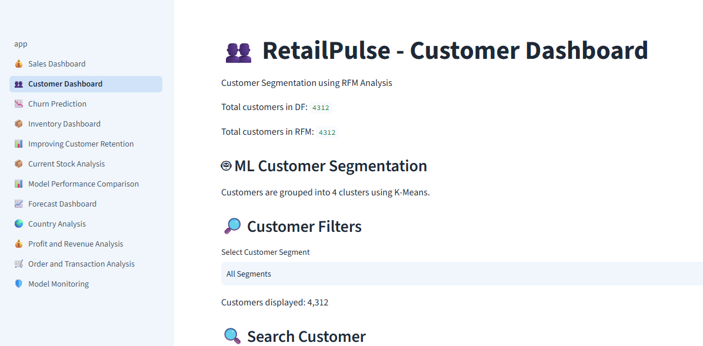

RetailPulse – AI-Powered Customer Analytics and Forecasting Platform

Project Overview

RetailPulse is an AI-powered customer analytics and demand forecasting platform designed to help retail businesses understand customer purchasing behaviour, predict customer churn, forecast product demand, and improve inventory management.

The platform combines data analytics, machine learning, forecasting techniques, and interactive dashboards to support data-driven business decisions.

Key Features

\- Sales Analytics: Analyze sales, revenue, orders, and business performance.

\- Customer Segmentation: Use RFM analysis to identify customer groups.

\- Churn Prediction: Predict customers who may stop purchasing.

\- Demand Forecasting: Forecast future sales using time-series models.

\- Inventory Optimization: Identify low-stock and high-demand products.

\- Model Monitoring: Monitor model performance and data drift.

\- Interactive Dashboard: Explore business insights using Streamlit.

\- Prediction API: Serve churn predictions using FastAPI.

Technology Stack

\- Python

\- Pandas and NumPy

\- Scikit-learn

\- Streamlit

\- FastAPI

\- MLflow

\- Evidently

\- Matplotlib

\- Time-series forecasting techniques

Project Architecture

1\. Data Layer: Retail transaction data.

2\. Feature Engineering Layer: Data cleaning, RFM analysis, lag features, and rolling averages.

3\. Model Layer: Machine learning and forecasting models with MLflow tracking.

4\. Serving Layer: Streamlit dashboards and FastAPI prediction endpoint.

5\. Monitoring Layer: Model performance tracking and data drift monitoring.

Project Structure

RetailPulse/

│

├── app.py

├── api.py

├── api\_test.py

├── requirements.txt

├── .gitignore

│

├── pages/

│   ├── Sales Dashboard

│   ├── Customer Dashboard

│   ├── Churn Prediction

│   ├── Inventory Dashboard

│   ├── Forecast Dashboard

│   └── Model Monitoring

│

├── data/

├── drift\_monitoring.py

├── model\_performance\_monitoring.py

├── mlflow\_churn\_training.py

├── run\_monitoring.py

└── README.md

Installation and Setup

Clone the repository:

git clone https://github.com/Dhana-web-coder/RetailPulse-AI-Customer-Analytics.git

Navigate to the project folder:

cd RetailPulse-AI-Customer-Analytics

Install the required packages:

pip install -r requirements.txt

Add the required retail dataset files to the appropriate data folder before running the application.

Run the Streamlit Application

streamlit run app.py

Run the FastAPI Application

uvicorn api:app --reload

Open the API documentation:

http://127.0.0.1:8000/docs

Model Monitoring

RetailPulse uses MLflow for model tracking and Evidently for data drift monitoring. It also includes model performance evaluation and monitoring reports.

Project Objective

The main objective of RetailPulse is to transform retail transaction data into meaningful business insights, improve customer retention, support demand planning, and optimize inventory decisions.

Author

Dhanalakshmi E

Data Analytics | Information Technology

GitHub: https://github.com/Dhana-web-coder
## RetailPulse Dashboard

RetailPulse – Turning Retail Data into Smart Business Decisions.
## 👥 Customer Dashboard

seaborn

